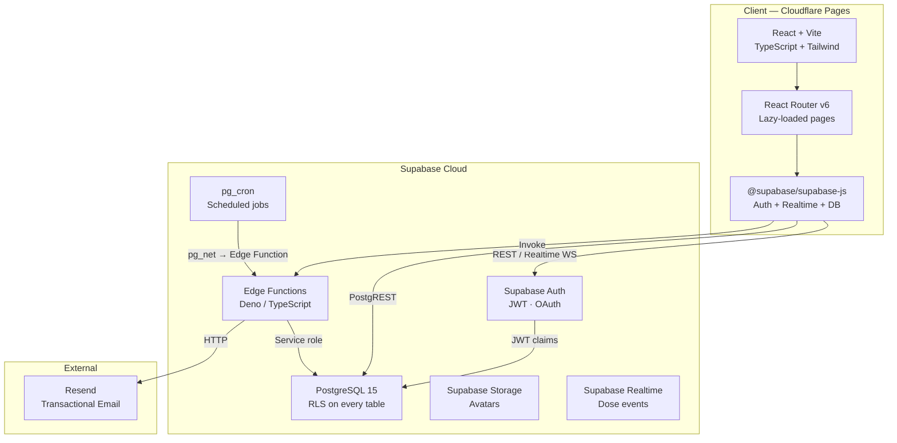
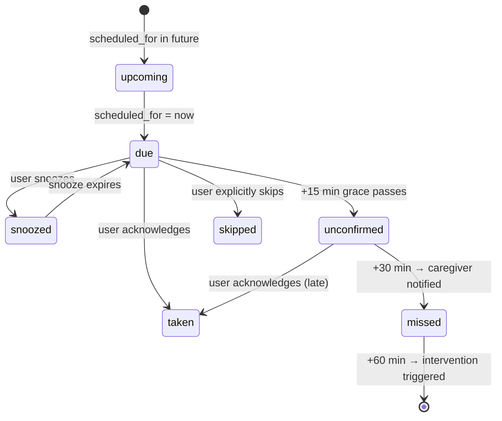
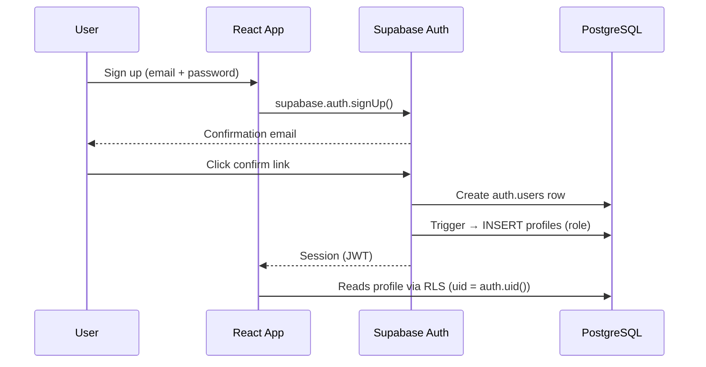

# CareCircle — Architecture Document

> **Version:** 1.0 · **Status:** Living Document · **Last Updated:** November 2026

---

## 1. System Overview

CareCircle is a production-grade **elderly healthcare management platform** designed to close the gap between elderly individuals, their family members, and professional caregivers. The system enables:

- **Medication tracking** — structured schedules, real-time dose acknowledgment, smart escalation
- **Appointment management** — doctor visits, reminders, history
- **Care-circle coordination** — permission-scoped access for family and caretakers
- **Adherence analytics** — trend reporting, missed-dose alerting
- **Automated notifications** — email via Resend, triggered by Supabase Cron jobs

### Design Principles

| Principle | Implementation |
|---|---|
| **Safety first** | Grace-period escalation: warn → notify caregiver → trigger intervention |
| **Accessibility** | 44 px touch targets, WCAG AA contrast, reduced-motion support |
| **Privacy by default** | Row-Level Security on every table; caregivers see only what they're permitted |
| **Offline resilience** | Optimistic UI updates; sync on reconnect |
| **Zero-credential leakage** | No secrets in `VITE_` variables; all backend secrets via Supabase CLI |

---

## 2. High-Level Architecture



---

## 3. Frontend Architecture

### 3.1 Layer Diagram

```
src/
├── pages/          ← Route-level components (lazy-loaded)
├── features/       ← Domain slices (auth, medications, appointments…)
│   └── <domain>/
│       ├── components/   ← Domain-specific UI
│       ├── hooks/        ← Data-fetching & mutation hooks
│       └── store/        ← Local state (Zustand / Context)
├── components/
│   ├── ui/         ← shadcn/ui primitives (Button, Dialog, Toast…)
│   └── layout/     ← AppShell, Sidebar, Header, MobileNav
├── hooks/          ← Shared hooks (useAuth, useProfile, useRealtime)
├── lib/            ← supabase.ts, utils.ts, constants.ts
├── services/       ← API service layer (medications, appointments…)
├── types/          ← index.ts (domain types), database.ts (DB types)
└── utils/          ← Pure helpers
```

### 3.2 Data Flow — Read Path

```
Page component
  └─► useQuery hook (feature/hooks)
        └─► Service layer (services/)
              └─► supabase.from('table').select(...)
                    └─► Supabase PostgREST → PostgreSQL (filtered by RLS)
```

### 3.3 Data Flow — Write Path (Medication Dose)

```
DoseCard → "Mark Taken" button
  └─► recordDose(scheduleId, 'taken')       [feature/adherence/hooks]
        └─► supabase.functions.invoke('record-dose', { body })
              └─► Edge Function validates permissions
                    ├─► INSERT dose_events
                    ├─► INSERT audit_logs
                    └─► Realtime broadcast → all caregivers' UI updates
```

### 3.4 Escalation State Machine



---

## 4. Backend Architecture — Supabase Edge Functions

| Function | Trigger | Purpose |
|---|---|---|
| `create-invitation` | Client invoke | Generates invitation token, sends email via Resend |
| `accept-invitation` | Client invoke | Validates token, creates `care_relationships` row |
| `manage-medication` | Client invoke | CRUD for medications + schedules (permission-checked) |
| `record-dose` | Client invoke | Records dose event, triggers escalation check |
| `manage-appointment` | Client invoke | CRUD for appointments (permission-checked) |
| `process-reminders` | pg_cron (every 5 min) | Queries upcoming doses/appointments, enqueues notifications |
| `process-missed-doses` | pg_cron (every 15 min) | Escalates unconfirmed → missed, notifies caregivers |
| `send-notification` | Queue consumer | Sends email via Resend, updates delivery status |

### Edge Function Pattern

```typescript
// Every function follows this structure:
Deno.serve(async (req) => {
  // 1. CORS preflight
  // 2. Auth: verify JWT, extract user
  // 3. Permission check against care_relationships
  // 4. Business logic
  // 5. Audit log INSERT
  // 6. Return typed ApiResponse<T>
})
```

---

## 5. Database Schema

### Core Tables

```
profiles            — extends auth.users (role, full_name, phone)
elderly_profiles    — elderly-specific data (DOB, emergency contact, timezone)
care_relationships  — links caregivers to elderly, stores permissions[]
invitations         — time-limited tokens for joining care circles
medications         — medication registry per elderly profile
medication_schedules— time + frequency per medication
dose_events         — actual dose records (taken/missed/skipped…)
appointments        — doctor appointments
notifications       — outbound notification queue
audit_logs          — immutable action trail
```

### RLS Strategy

Every table has Row-Level Security **enabled with no public access**. Policies follow:

1. **Elderly users** — full access to their own profile data
2. **Caregivers** — SELECT/INSERT/UPDATE gated by `care_relationships.permissions`
3. **Service role** (Edge Functions) — bypasses RLS for system operations

```sql
-- Example: caregivers may view medications if they have view_medications permission
CREATE POLICY "caregivers_view_medications" ON medications
  FOR SELECT USING (
    EXISTS (
      SELECT 1 FROM care_relationships cr
      WHERE cr.elderly_profile_id = medications.elderly_profile_id
        AND cr.caregiver_user_id = auth.uid()
        AND cr.status = 'active'
        AND 'view_medications' = ANY(cr.permissions)
    )
  );
```

---

## 6. Authentication & Authorization

### Auth Flow



### Permission Model

| Role | Default Permissions |
|---|---|
| `elderly` | Full access to own data |
| `family` | view_medications, view_appointments, view_adherence, receive_notifications |
| `caretaker` | view_medications, view_appointments, record_doses, view_adherence, receive_notifications |

Permissions are **per-relationship** — a user may be a family member for one elderly profile and a caretaker for another, with different permissions each time.

---

## 7. Notification System

```
pg_cron (every 5 min)
  └─► process-reminders edge function
        ├─► Query: medications due in next 30 min
        ├─► Query: appointments tomorrow
        └─► INSERT notifications (status=pending)

pg_cron (every 15 min)
  └─► process-missed-doses edge function
        ├─► Query: unconfirmed doses > 15 min old → status='missed'
        └─► INSERT notifications for caregivers

Notification queue consumer (send-notification)
  └─► Resend API → email delivery
        └─► UPDATE notifications (status=sent|failed, delivered_at)
```

**Retry policy:** up to 3 retries with exponential backoff. After 3 failures, `delivery_status = 'failed'` and an alert is logged.

---

## 8. Security Model

| Concern | Mitigation |
|---|---|
| Secret leakage | No secrets in `VITE_` env vars; backend secrets via `supabase secrets set` |
| SQL injection | PostgREST parameterized queries; no raw SQL in Edge Functions |
| Unauthorized access | RLS on every table; permission array checked in every policy |
| Token hijacking | Short JWT expiry (1h); auto-refresh; `persistSession` in secure storage |
| CORS | Edge Functions return strict `Access-Control-Allow-Origin` |
| Audit trail | Every mutation logged to `audit_logs` (immutable — no UPDATE/DELETE RLS policy) |
| Invitation abuse | 48h expiry, single-use token, 32-byte random, consumed_at set atomically |

---

## 9. Deployment Architecture

```
Developer → git push → GitHub
  └─► Cloudflare Pages (CI/CD)
        ├─► npm run build  (Vite → dist/)
        ├─► Deploy to CDN edge nodes (global)
        └─► Set VITE_SUPABASE_URL, VITE_SUPABASE_ANON_KEY as Pages env vars

Supabase
  ├─► Managed PostgreSQL 15 (primary + read replicas)
  ├─► Edge Functions deployed via: supabase functions deploy <name>
  ├─► Secrets: supabase secrets set RESEND_API_KEY=xxx
  └─► Migrations: supabase db push (supabase/migrations/*.sql)
```

### Environment Variables

| Variable | Where Set | Purpose |
|---|---|---|
| `VITE_SUPABASE_URL` | Cloudflare Pages env / `.env.local` | Supabase project URL |
| `VITE_SUPABASE_ANON_KEY` | Cloudflare Pages env / `.env.local` | Public anon key |
| `VITE_APP_URL` | Cloudflare Pages env / `.env.local` | App base URL |
| `RESEND_API_KEY` | Supabase secrets | Email API key (never in VITE_) |
| `SUPABASE_SERVICE_ROLE_KEY` | Supabase secrets (injected automatically) | Service role for Edge Functions |

---

## 10. Technology Decisions

| Decision | Choice | Rationale |
|---|---|---|
| Frontend framework | React 18 + TypeScript | Ecosystem maturity, concurrent features, strong typing |
| Build tool | Vite | Fast HMR, ESM-first, excellent DX |
| Styling | Tailwind CSS + shadcn/ui | Utility-first speed + accessible, composable primitives |
| Backend | Supabase Edge Functions | No server infra; co-located with DB; Deno security model |
| Database | Supabase PostgreSQL | Managed, RLS native, real-time built-in, pg_cron for scheduling |
| Auth | Supabase Auth | Integrated with RLS JWT claims; no custom auth server |
| Email | Resend | Modern API, deliverability, React Email templates |
| Routing | React Router v6 | Declarative, nested routes, lazy loading |
| Forms | React Hook Form + Zod | Performant, schema-validated, type-safe |
| Testing | Vitest + RTL + Playwright | Fast unit tests, component testing, E2E |
| Deployment | Cloudflare Pages | Global CDN, free tier, automatic preview deployments |

---

## 11. Testing Strategy

```
tests/
├── unit/           ← Vitest: pure functions (utils, constants, services)
├── integration/    ← Vitest + RTL: component + hook integration
└── e2e/            ← Playwright: critical user flows
    ├── auth.spec.ts          (sign up, login, logout)
    ├── medications.spec.ts   (add, schedule, record dose)
    ├── appointments.spec.ts  (create, complete, cancel)
    └── care-circle.spec.ts   (invite, accept, revoke)
```

**Coverage target:** 80% unit/integration; 100% of critical user paths in E2E.

---

## 12. Future Considerations

- **Mobile app** — React Native with shared business logic via a monorepo
- **AI features** — NLP schedule parsing (already typed as `ParsedSchedule`), medication interaction warnings
- **Offline-first** — Service Worker + IndexedDB for dose acknowledgment without connectivity
- **Localization** — i18n for multilingual elderly populations
- **Wearable integration** — Apple HealthKit / Google Fit for passive adherence tracking
