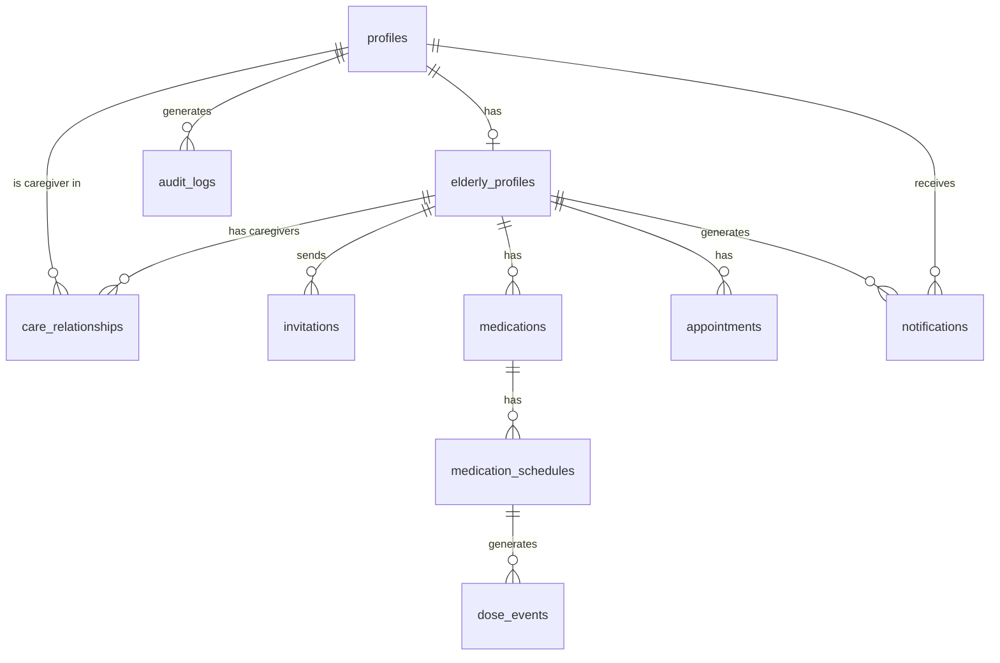

# CareCircle Database Documentation

> [!IMPORTANT]
> All migrations live in `supabase/migrations/` and must be applied in order (001–005). The seed file is for **development only** and lives at `supabase/seed.sql`.

---

## Migration Files

| File | Purpose |
|------|---------|
| `001_initial_schema.sql` | Creates all tables with constraints |
| `002_indexes.sql` | Performance indexes |
| `003_rls_policies.sql` | Row Level Security + helper functions |
| `004_functions_triggers.sql` | Triggers, auto-profile creation, audit logging |
| `005_cron_jobs.sql` | pg_cron scheduled jobs |
| `supabase/seed.sql` | Development test data |

---

## Tables

### `public.profiles`
Central user profile table, one row per auth user.

| Column | Type | Notes |
|--------|------|-------|
| `id` | UUID PK | References `auth.users(id)` |
| `email` | TEXT | Required |
| `full_name` | TEXT | Required |
| `phone` | TEXT | Optional |
| `role` | TEXT | `elderly`, `family`, or `caretaker` |
| `avatar_url` | TEXT | Optional |
| `created_at` | TIMESTAMPTZ | Auto-set |
| `updated_at` | TIMESTAMPTZ | Auto-updated via trigger |

---

### `public.elderly_profiles`
Extended medical/personal details for elderly users. Auto-created when a user signs up with `role = 'elderly'`.

| Column | Type | Notes |
|--------|------|-------|
| `id` | UUID PK | |
| `user_id` | UUID FK | → `profiles(id)`, unique |
| `date_of_birth` | DATE | Optional |
| `medical_notes` | TEXT | Free text, sensitive |
| `emergency_contact` | TEXT | Contact name |
| `emergency_phone` | TEXT | Contact phone |
| `preferred_timezone` | TEXT | IANA timezone (default: `UTC`) |

---

### `public.care_relationships`
Links a caregiver (family/caretaker) to an elderly profile with granular permissions.

| Column | Type | Notes |
|--------|------|-------|
| `id` | UUID PK | |
| `elderly_profile_id` | UUID FK | → `elderly_profiles(id)` |
| `caregiver_user_id` | UUID FK | → `profiles(id)` |
| `relationship_type` | TEXT | `family` or `caretaker` |
| `permissions` | TEXT[] | Array of permission strings |
| `status` | TEXT | `active`, `revoked`, `pending` |

**Permission strings:** `view_medications`, `manage_medications`, `view_adherence`, `record_doses`, `view_appointments`, `manage_appointments`

---

### `public.invitations`
Time-limited invitation codes to onboard caregivers.

| Column | Type | Notes |
|--------|------|-------|
| `id` | UUID PK | |
| `elderly_profile_id` | UUID FK | → `elderly_profiles(id)` |
| `code_hash` | TEXT | SHA-256 of the actual invite code |
| `invited_email` | TEXT | Email the invite is for |
| `role` | TEXT | `family` or `caretaker` |
| `permissions` | TEXT[] | Permissions to grant on acceptance |
| `expires_at` | TIMESTAMPTZ | Must be in the future |
| `consumed_at` | TIMESTAMPTZ | Set when accepted |
| `attempt_count` | INTEGER | 0–10, rate limit guard |
| `created_by` | UUID FK | → `profiles(id)` |

---

### `public.medications`
Prescribed medications for an elderly user.

| Column | Type | Notes |
|--------|------|-------|
| `id` | UUID PK | |
| `elderly_profile_id` | UUID FK | → `elderly_profiles(id)` |
| `medicine_name` | TEXT | 1–255 chars |
| `dosage_instructions` | TEXT | Required |
| `notes` | TEXT | Optional |
| `start_date` | DATE | Required |
| `end_date` | DATE | Optional; must be ≥ start_date |
| `status` | TEXT | `active`, `inactive`, `completed` |
| `created_by` | UUID FK | → `profiles(id)` |

---

### `public.medication_schedules`
When and how often each medication should be taken.

| Column | Type | Notes |
|--------|------|-------|
| `id` | UUID PK | |
| `medication_id` | UUID FK | → `medications(id)` |
| `scheduled_time` | TIME | Time of day |
| `frequency` | TEXT | `daily`, `twice_daily`, `three_times_daily`, `weekly`, `as_needed`, `custom` |
| `timezone` | TEXT | IANA timezone |
| `active` | BOOLEAN | Soft-disable without deleting |
| `days_of_week` | INTEGER[] | NULL = every day; 0=Sun … 6=Sat |

---

### `public.dose_events`
Individual dose occurrences generated from schedules. One row per (schedule, time) pair.

| Column | Type | Notes |
|--------|------|-------|
| `id` | UUID PK | |
| `medication_schedule_id` | UUID FK | → `medication_schedules(id)` |
| `scheduled_for` | TIMESTAMPTZ | Exact scheduled datetime |
| `status` | TEXT | `upcoming`, `due`, `taken`, `skipped`, `missed`, `snoozed`, `unconfirmed` |
| `acknowledged_at` | TIMESTAMPTZ | When a terminal action was recorded |
| `recorded_by` | UUID FK | → `profiles(id)` |
| `notes` | TEXT | Optional |
| `snoozed_until` | TIMESTAMPTZ | Set when snoozed |

**Unique:** `(medication_schedule_id, scheduled_for)`

---

### `public.appointments`
Scheduled doctor appointments for elderly users.

| Column | Type | Notes |
|--------|------|-------|
| `id` | UUID PK | |
| `elderly_profile_id` | UUID FK | → `elderly_profiles(id)` |
| `doctor_name` | TEXT | 1–255 chars |
| `hospital_name` | TEXT | Optional |
| `appointment_date` | DATE | Required |
| `appointment_time` | TIME | Required |
| `timezone` | TEXT | IANA timezone |
| `purpose` | TEXT | Optional |
| `notes` | TEXT | Optional |
| `status` | TEXT | `scheduled`, `completed`, `cancelled` |
| `reminder_sent` | BOOLEAN | Tracks if reminder dispatched |
| `created_by` | UUID FK | → `profiles(id)` |

---

### `public.notifications`
Outbound notification queue. Idempotent — deduplicated by `(recipient, type, event_id)`.

| Column | Type | Notes |
|--------|------|-------|
| `id` | UUID PK | |
| `elderly_profile_id` | UUID FK | → `elderly_profiles(id)` |
| `recipient_user_id` | UUID FK | → `profiles(id)` |
| `notification_type` | TEXT | `upcoming_medication`, `unconfirmed_medication`, `missed_medication`, `upcoming_appointment`, `invitation`, `caregiver_intervention` |
| `related_event_id` | UUID | Polymorphic reference |
| `related_event_type` | TEXT | `dose_event`, `appointment`, etc. |
| `delivery_status` | TEXT | `pending`, `sent`, `delivered`, `failed`, `skipped` |
| `scheduled_at` | TIMESTAMPTZ | When to send |
| `delivered_at` | TIMESTAMPTZ | When delivered |
| `retry_count` | INTEGER | 0–5 |
| `last_error` | TEXT | Last error if failed |
| `read_at` | TIMESTAMPTZ | When user read it |

---

### `public.audit_logs`
Immutable append-only audit trail. Inserted via `public.create_audit_log()`.

| Column | Type | Notes |
|--------|------|-------|
| `id` | UUID PK | |
| `user_id` | UUID FK | → `profiles(id)`, nullable (SET NULL on delete) |
| `action` | TEXT | e.g., `create`, `update`, `delete` |
| `resource_type` | TEXT | Table name |
| `resource_id` | TEXT | PK of affected row |
| `metadata` | JSONB | Before/after snapshots, context |
| `ip_address` | INET | Optional |
| `created_at` | TIMESTAMPTZ | Immutable |

---

## Entity Relationship Diagram



---

## RLS Policy Summary

> [!NOTE]
> All tables have RLS enabled. The `service_role` key (used in Edge Functions) bypasses RLS by design. Never expose the service role key client-side.

### Helper Functions

| Function | Description |
|----------|-------------|
| `get_user_role()` | Returns the current user's role string |
| `is_elderly_owner(elderly_profile_id)` | Returns `TRUE` if `auth.uid()` owns the elderly profile |
| `has_care_relationship(elderly_profile_id)` | Returns `TRUE` if user has any active care relationship |
| `has_permission(elderly_profile_id, permission)` | Returns `TRUE` if user has that specific permission |

### Policy Matrix

| Table | Elderly Owner | Caregiver (with permission) | Recipient |
|-------|:---:|:---:|:---:|
| `profiles` | SELECT own, INSERT own, UPDATE own | SELECT if care-related | — |
| `elderly_profiles` | SELECT, INSERT, UPDATE own | SELECT (has_care_relationship) | — |
| `care_relationships` | SELECT, INSERT, UPDATE | SELECT own rows | — |
| `invitations` | SELECT, INSERT, UPDATE | — | — |
| `medications` | SELECT, INSERT, UPDATE | SELECT (`view_medications`), INSERT/UPDATE (`manage_medications`) | — |
| `medication_schedules` | Via medication ownership | Via `view_medications` / `manage_medications` | — |
| `dose_events` | Via schedule → medication | Via `view_adherence` / `record_doses` | — |
| `appointments` | SELECT, INSERT, UPDATE | SELECT (`view_appointments`), INSERT/UPDATE (`manage_appointments`) | — |
| `notifications` | SELECT (as elderly owner) | — | SELECT, UPDATE own |
| `audit_logs` | SELECT own rows | — | — |

---

## Index Strategy

### Lookup indexes
- `idx_profiles_email` — user lookup by email during auth
- `idx_elderly_profiles_user_id` — join from profile to elderly_profile
- `idx_care_relationships_elderly / _caregiver` — both sides of relationship queries

### Filtered (partial) indexes
- `idx_invitations_expires WHERE consumed_at IS NULL` — only unexpired active invites
- `idx_dose_events_unconfirmed WHERE status = 'unconfirmed'` — cron job target
- `idx_dose_events_missed WHERE status IN ('missed','unconfirmed')` — alert queries
- `idx_appointments_upcoming WHERE status = 'scheduled'` — reminder job target
- `idx_notifications_scheduled WHERE delivery_status = 'pending'` — notification worker
- `idx_notifications_unread WHERE read_at IS NULL` — unread badge counts

### Composite indexes
- `idx_medications_elderly_status (elderly_profile_id, status)` — active medication list
- `idx_appointments_upcoming (appointment_date, appointment_time)` — ordered upcoming

---

## Cron Jobs

| Job Name | Schedule | Handler |
|----------|----------|---------|
| `process-medication-reminders` | Every 15 min | `/process-reminders` (medication_reminder) |
| `process-missed-doses` | Every 30 min | `/process-missed-doses` |
| `process-appointment-reminders` | Daily 8 AM UTC | `/process-reminders` (appointment_reminder) |

Cron jobs call Edge Functions via `pg_net.http_post`. Requires `app.edge_function_url` and `app.service_role_key` to be set as database configuration parameters.

---

## Migration Instructions

### Local Development (Supabase CLI)

```bash
# Start local Supabase
supabase start

# Apply all migrations
supabase db push

# Seed development data
supabase db reset  # applies migrations + seed.sql automatically

# Or seed manually
psql -h localhost -p 54322 -U postgres -d postgres -f supabase/seed.sql
```

### Production

```bash
# Link to your Supabase project
supabase link --project-ref <your-project-ref>

# Push migrations to production
supabase db push

# DO NOT run seed.sql in production
```

> [!CAUTION]
> Never run `supabase/seed.sql` in a production environment. It contains fixed UUIDs and placeholder user records intended only for local development and CI.

> [!WARNING]
> Migration 005 (`005_cron_jobs.sql`) requires the `pg_cron` and `pg_net` extensions to be enabled in your Supabase project (Dashboard → Database → Extensions). These are available on Pro plans and above.

### Setting cron configuration parameters

In the Supabase SQL editor, run:

```sql
ALTER DATABASE postgres SET app.edge_function_url = 'https://<project-ref>.supabase.co/functions/v1';
ALTER DATABASE postgres SET app.service_role_key = '<your-service-role-key>';
```

> [!CAUTION]
> Treat `app.service_role_key` as a secret. Do not commit it to source control.
